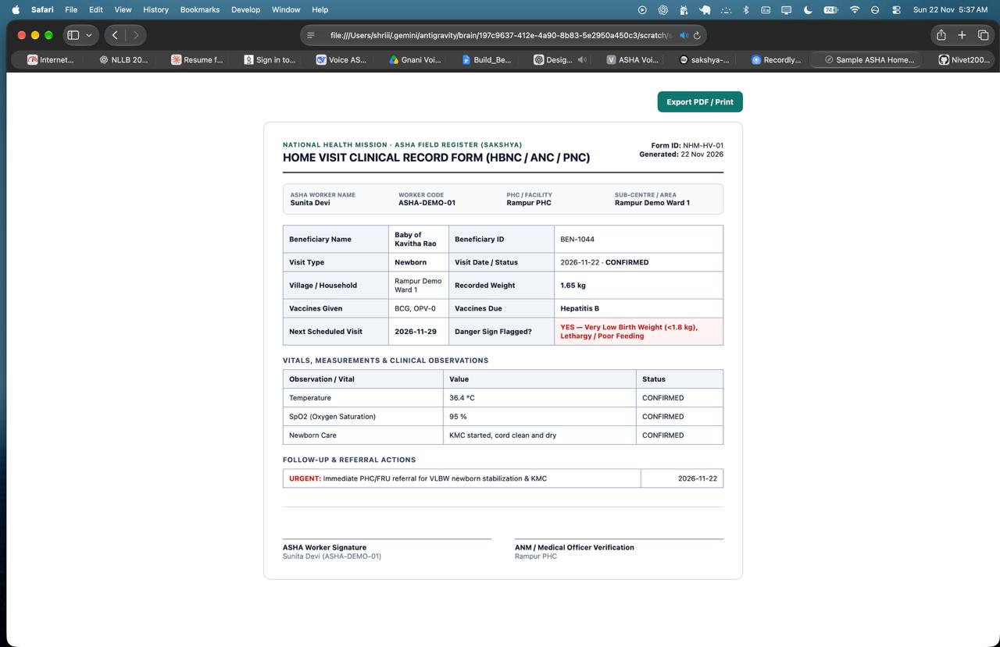
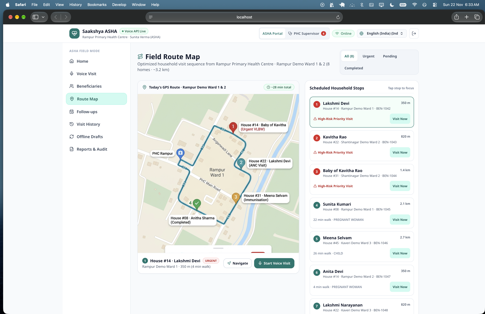
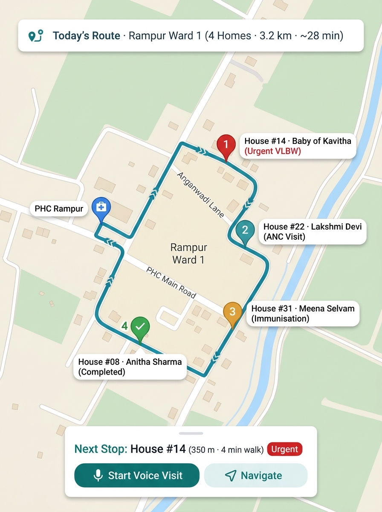

# ASHA Voice Field Register (Saakshya)

Voice-first maternal, newborn, and immunisation home-visit register and emergency referral assistant for **ASHAs (Accredited Social Health Activists)** and **PHC Supervisors** under India's **National Health Mission (NHM)**.

Converts noisy, spoken household-visit notes in Indic languages and natural Indic-English code-mixing into confirmed, schema-validated visit records—with spoken read-back, selective field correction, exact numeric/unit parsing, and immediate deterministic escalation of verified danger signs requiring urgent Primary Health Centre (PHC/FRU) referral.

**Three Integrated Components:**
1. **Python Voice & Healthcare AI Backend (`backend/`)** — FastAPI WebSocket orchestrator (`Gnani Prisma v3.0` STT, `Gnani Timbre v3.0` TTS, ONNX Silero VAD barge-in, Gemini/Groq LLM adapters, exact-`Decimal` numeric/date extraction, NHM danger-sign & clinical risk engines).
2. **Next.js Clinical Web Application (`sakshya-web-main/`)** — Bilingual/multilingual ASHA worker & PHC supervisor web workspace with live microphone streaming, Audio Diagnostics, Offline IndexedDB drafts, Printable NHM Reports, and Supabase/Firebase sync.
3. **Companion Android Mobile App (`../sakshya-app` — *Saakshya ASHA*)** — React Native + Expo Android field app with native 16 kHz `pcm_s16le` hardware `AudioRecord` capture, Push-to-Talk voice workflow, Firebase Firestore + Android Room persistence, and standalone Release APK builds.

---

## Demo Videos & Screenshots

### 1. Voice Visit Demo — English

<div align="center">
  <iframe width="100%" height="480" src="https://www.youtube.com/embed/95zhO-07A8E" title="Saakshya - English Voice Visit Demo" frameborder="0" allow="accelerometer; autoplay; clipboard-write; encrypted-media; gyroscope; picture-in-picture; web-share" referrerpolicy="strict-origin-when-cross-origin" allowfullscreen style="width: 100%; max-width: 850px; aspect-ratio: 16 / 9; border-radius: 12px; border: 0;"></iframe>
</div>

<p align="center">
  <a href="https://www.youtube.com/watch?v=95zhO-07A8E">▶ <b>Watch English Voice Visit Demo on YouTube</b></a> &nbsp;|&nbsp; <a href="docs/media/english.mp4">Local MP4 Stream</a>
</p>

### 2. Voice Visit Demo — Tamil (தமிழ்)

<div align="center">
  <iframe width="100%" height="480" src="https://www.youtube.com/embed/sJQvE8ixwz0" title="Saakshya - Tamil Voice Visit Demo" frameborder="0" allow="accelerometer; autoplay; clipboard-write; encrypted-media; gyroscope; picture-in-picture; web-share" referrerpolicy="strict-origin-when-cross-origin" allowfullscreen style="width: 100%; max-width: 850px; aspect-ratio: 16 / 9; border-radius: 12px; border: 0;"></iframe>
</div>

<p align="center">
  <a href="https://www.youtube.com/watch?v=sJQvE8ixwz0">▶ <b>Watch Tamil Voice Visit Demo on YouTube</b></a> &nbsp;|&nbsp; <a href="docs/media/tamil.mp4">Local MP4 Stream</a>
</p>

### 3. Auto-Filled ASHA Field Report & PDF Export Screenshot


### 4. Auto Route Map Generator for ASHA Workers (Google Maps Navigation)
Automatically sequences an ASHA worker's daily household visits from the Primary Health Centre (PHC), highlights urgent high-risk/VLBW priority homes, and provides one-click **Navigate** (integrated directly with Google Maps) and **Start Voice Visit** actions.





---

## 1. Architecture & Voice Pipeline

```text
Mic Audio (16 kHz, mono, pcm_s16le, 512 samples / 1024 B / 32 ms)
   │  (Web Audio / CLI sounddevice / Android PcmAudioRecorderModule.kt)
   ▼
FastAPI Full-Duplex WebSocket (/ws/voice/{session_id})
   ├──► Dual-Gate ONNX Silero VAD (barge-in >= 192 ms -> prompt tts_cancelled)
   ├──► Gnani Prisma v3.0 Streaming STT (x-format: transcribe + ITN + context headers)
   │       ├──► Per-Worker Correction Memory + Abbreviation Expansion
   │       ├──► Layer 1: Deterministic Multilingual NHM Danger-Sign Engine (44 entries)
   │       │            └─ Immediate interrupt + danger_alert + urgent PHC referral TTS
   │       ├──► Exact-Decimal Numeric, Unit, Date & Beneficiary Extraction
   │       │            └─ Optional Gnani REST Secondary Recognition on uncertain numbers
   │       └──► 9-State Visit Conversation Machine (Read-back -> Patch -> Confirm-before-save)
   └──► LLM Adapter (Gemini / Groq fallback) ──► Gnani Timbre v3.0 Streaming TTS ──► Audio Out
```

### Core Capabilities

- **Numeric-Oriented Gnani Prisma v3.0 Configuration:** Uses `prisma-v3.0` with primary `x-format: transcribe` (enabling upstream Inverse Text Normalisation for numbers, weights, and dates), partial + final streaming events, automatic/configured language ID (`hi-IN`, `kn-IN`, `ta-IN`, `en-IN`, `indic-auto`, and extended UI languages), and contextual headers (`x-keywords`, `x-speaker-names`, `x-previous-text`, `x-topic`) plus mid-session `update_settings`.
- **Dedicated Exact-`Decimal` Extraction & Secondary Recognition (`backend/app/extraction/`):**
  - Specialized parsers for English, Hindi, Kannada, Tamil, and code-mixed spoken numbers, decimals, grams/kilograms conversion, dates (`dates.py`), beneficiary IDs (`BEN-XXXX`), and repeated spoken self-corrections (`numbers.py`, `extractor.py`) while preserving original spoken evidence alongside normalized values.
  - Healthcare abbreviation expansion (`abbreviations.py`: `ANC`, `PNC`, `HBNC`, `BP`, `Hb`, `SpO2`, `KMC`, `ORS`, `IFA`, `PHC`, `FRU`, etc.).
  - Optional secondary re-evaluation (`secondary_recognition.py` via `GnaniRestSecondaryRecognizer` in `codemix` mode) on retained utterance audio when critical numbers look uncertain or inconsistent, plus configurable `MANDATORY_NUMERIC_CONFIRMATION` read-back.
- **Safety-Critical NHM Danger-Sign Engine (`backend/app/danger_signs/`) & Risk Stratification (`backend/app/healthcare/risk_engine.py`):**
  - 44 catalog entries grounded in official MoHFW/NHSRC protocols with source, section, and page mappings.
  - Handles negation, historical context, and third-person mentions; interrupts ongoing read-back immediately upon verified detection, sets `danger_sign_flagged=true`, emits urgent `danger_alert` events, and triggers immediate PHC referral speech without diagnosing or prescribing.
  - Deterministic clinical risk stratification across Pregnant Mother (`ANC`/`PNC`), Child (`Newborn`/`Infant`), Adult, and Elderly lifecycles (`POST /api/v1/clinical/assess-risk`).
- **Per-Worker Correction Memory (`backend/app/services/worker_memory.py`):** JSON-persisted per-worker correction store (`GET/POST /api/v1/workers/{worker_id}/corrections`) that applies learned ASR fixes deterministically and feeds frequent corrections back into STT keyterm biasing.
- **Read-Back & Confirm-Before-Save State Machine (`backend/app/conversation/state_machine.py`):** Reads extracted fields aloud, supports targeted voice corrections (*"No, weight is 2.8 kilo"* — patching only the targeted field), re-reads changes, and never marks an unconfirmed draft as committed.

---

## 2. Repository Layout

```text
sakshya-web/
├── start_demo.py                         # Cross-platform one-click backend + frontend launcher
├── start_demo.command / start_demo.bat   # macOS double-click & Windows batch launchers
├── .env.example                          # Environment variable template (no real secrets)
├── backend/
│   ├── requirements.txt                  # Pinned Python 3.12 dependencies
│   ├── cli_client.py                     # Minimal local microphone/playback CLI test client
│   ├── app/
│   │   ├── main.py                       # FastAPI entrypoint
│   │   ├── api/                          # REST routes (routes.py) & WebSocket handler (ws.py)
│   │   ├── conversation/                 # 9-state conversation machine & draft models
│   │   ├── core/                         # Config (env aliases + contextual STT options), logging, telemetry
│   │   ├── danger_signs/                 # 44-entry NHM catalog, normalizer & deterministic detector
│   │   ├── extraction/                   # numbers.py, dates.py, abbreviations.py, extractor.py,
│   │   │                                 # secondary_recognition.py, metrics.py, models.py
│   │   ├── healthcare/                   # Orchestration pipeline & deterministic clinical risk_engine.py
│   │   ├── services/                     # Synthetic beneficiary directory & worker_memory.py
│   │   └── voice/                        # Gnani Prisma STT, Gnani Timbre TTS, Gemini/Groq LLM, Silero ONNX VAD
│   ├── scripts/
│   │   ├── benchmark_prisma_numeric.py   # Live Transcribe vs Code-Mix 7-metric numeric benchmark
│   │   └── test_live_stt.py              # Live Gnani Prisma STT diagnostic probe
│   └── tests/                            # 16 unit/integration/live verification test files
├── sakshya-web-main/                     # Next.js 14 Clinical Web Application
│   ├── package.json
│   └── src/components/
│       ├── asha/                         # Home, Directory, Follow-ups, History, Offline, Reports, AddPatient
│       ├── supervisor/                   # Supervisor Overview/Alerts, Workers/Register, Analytics/Reports
│       └── voice/                        # Basic & Advanced Visit Views, Recorder, AudioDiagnosticsPanel
├── shared-contracts/                     # Versioned v1 JSON Schemas, OpenAPI spec & mock JSONL events
├── docs/                                 # Architecture, Gnani integration, Android Room schema, NHM citations
└── firebase.json / firestore.rules       # Firebase hosting & Firestore configuration

../sakshya-app/                           # Sibling repository: Saakshya ASHA Android Mobile App (React Native + Expo)
```

---

## 3. Quick Start (Backend + Next.js Web)

### Option A: One-Click Local Launcher (Recommended)

Use the platform-specific one-click launcher (`start_demo.bat` for Windows, `start_demo.command` for macOS). Both automatically validate prerequisites (`python3 >= 3.11`, `node`, `npm`), initialize `.env` and `sakshya-web-main/.env.local` if missing, set up `backend/.venv` and `node_modules`, start FastAPI (`http://localhost:8000`) and Next.js (`http://localhost:3000`), and open the app in your browser:

- **Windows:** Double-click **`start_demo.bat`** in File Explorer, or run from Command Prompt / PowerShell:
  ```bat
  start_demo.bat
  ```

- **macOS:** Double-click **`start_demo.command`** in Finder (if needed once, make executable with `chmod +x start_demo.command`), or run from Terminal:
  ```bash
  ./start_demo.command
  ```

- **Cross-Platform CLI Options (`start_demo.py`):**
  ```bash
  python3 start_demo.py --check-only   # Verify environment and health without launching UI
  python3 start_demo.py --no-browser   # Start servers in terminal without opening browser
  python3 start_demo.py --with-cli     # Also open the terminal CLI voice client alongside Web UI
  ```

### Option B: Manual Backend Setup

> Do **not** run `git init` or commit secrets. Copy `.env.example` to root `.env` and fill in your own provider credentials.

```bash
python3 -m venv backend/.venv
source backend/.venv/bin/activate
pip install --upgrade pip
pip install -r backend/requirements.txt

cd backend
uvicorn app.main:app --host 0.0.0.0 --port 8000
```

Verify health:
```bash
curl -s http://localhost:8000/health
```

Run the terminal CLI voice harness (in another terminal with `backend/.venv` activated):
```bash
cd backend
python cli_client.py --language indic-auto
```

### Option C: Manual Next.js Web Setup

```bash
cd sakshya-web-main
npm install
npm run dev
# Opens on http://localhost:3000 (Next.js 14.2.18 + React 18.3.1)
```

---

## 4. Environment Configuration (Root `.env`)

All credentials live strictly in root `.env` (git-ignored) and are consumed by the backend—never embedded in web or mobile bundles. Key variables defined in `backend/app/core/config.py` and `.env.example`:

| Group | Variables | Purpose / Default |
|---|---|---|
| **Gnani STT & TTS** | `GNANI_API_KEY`, `GNANI_STT_MODEL`, `GNANI_TTS_MODEL`, `GNANI_STT_WS_URL`, `GNANI_TTS_WS_URL`, `GNANI_TTS_VOICE`, `GNANI_STT_FORMAT`, `GNANI_STT_ENABLE_PARTIALS`, `GNANI_STT_SECONDARY_ENABLED`, `GNANI_STT_SECONDARY_FORMAT`, `MANDATORY_NUMERIC_CONFIRMATION` | `prisma-v3.0` (default `transcribe`), `timbre-v3.0` (`Shivani`), optional secondary `codemix` re-check & forced numeric confirmation |
| **LLM Providers** | `LLM_PROVIDER`, `LLM_MODEL`, `GEMINI_API_KEY`, `LLM_FALLBACK_PROVIDER`, `LLM_FALLBACK_MODEL`, `GROQ_API_KEY`, `OPENROUTER_API_KEY` | Primary `gemini` + fallback `groq` (`llama-3.1-8b-instant`) |
| **Server & Audio** | `APP_ENV`, `HOST`, `PORT`, `LOG_LEVEL`, `LOG_REDACT_PHI`, `DEFAULT_LANGUAGE`, `SUPPORTED_LANGUAGES`, `AUDIO_SAMPLE_RATE`, `VAD_THRESHOLD`, `BARGE_IN_VAD_THRESHOLD`, `BARGE_IN_MIN_SPEECH_MS`, `ENDPOINT_SILENCE_MS` | `16000 Hz`, `LOG_REDACT_PHI=true`, dual-gate barge-in (`0.70` prob / `192 ms` speech) |
| **Safety & Storage** | `SYNTHETIC_DATA_ONLY`, `DANGER_SIGN_PARTIAL_MATCHING`, `SUPABASE_URL`, `SUPABASE_SERVICE_ROLE_KEY` | Synthetic-only guard & optional server-side Supabase integration |

---

## 5. Next.js Web Application (`sakshya-web-main/`)

Built with **Next.js `14.2.18`**, **React `18.3.1`**, **Tailwind CSS**, **Framer Motion**, **Supabase SSR**, **Firebase JS SDK**, and **IndexedDB (`idb`)**:

- **ASHA Worker Workspace:**
  - **Basic Mode & Advanced Mode** sharing one live voice session and `VisitDraft` state (`BasicVisitView.tsx`, `AdvancedVisitView.tsx`, `VoiceVisitWorkspace.tsx`).
  - **Live Audio Diagnostics (`AudioDiagnosticsPanel.tsx`):** Mic device selector, input level & 16-band waveform meter, WebSocket connection diagnostics, and text-utterance injection for noisy/headless testing.
  - **Field Operations Views:** Home dashboard (`AshaHomeView.tsx`), Beneficiary Directory + Voice/Modal Patient Onboarding (`BeneficiaryDirectoryView.tsx`), Follow-up Queue (`FollowUpQueueView.tsx`), Offline Sync Queue (`OfflineDraftsView.tsx`), Visit History (`VisitHistoryView.tsx`), and NHM Form/Register/Referral Slip Generation (`AshaReportsView.tsx`).
- **PHC Supervisor Portal:** Real-time active danger alerts & escalation (`SupervisorOverviewAndAlerts.tsx`), ASHA directory & visit register (`SupervisorWorkersAndRegister.tsx`), and programme analytics & CSV exports (`SupervisorAnalyticsAndReports.tsx`).

---

## 6. Companion Android Mobile App (`Saakshya ASHA` — `../sakshya-app`)

The field mobile client lives in the sibling repository **`sakshya-app`** (`React Native 0.74.5 + Expo 51`), engineered to pair directly with this FastAPI Voice Backend over REST and `/ws/voice`.

### Mobile Highlights

- **Basic & Advanced Voice Visit Modes:** Streamlined Basic Mode (11 Indic language options: `hi-IN`, `kn-IN`, `ta-IN`, `te-IN`, `ml-IN`, `bn-IN`, `mr-IN`, `gu-IN`, `pa-IN`, `en-IN`, `indic-auto`, live waveform, spoken read-back, selective voice correction, confirm-before-save) and detailed Advanced Clinical Form Mode sharing the same `VisitDraft` state.
- **Native 16 kHz `pcm_s16le` Audio Pipeline (`PcmAudioRecorderModule.kt`):** Uses Android's `AudioRecord` (`16000 Hz`, mono, `ENCODING_PCM_16BIT`) with hardware `AcousticEchoCanceler` and `NoiseSuppressor` plus `PcmAudioLevel` waveform events—avoiding lossy compressed MediaRecorder formats.
- **Push-to-Talk Workflow & Resilient WebSockets:** Press-and-hold mic orb (`onPressIn` -> `onPressOut`) streams PCM frames + trailing silence; supports **Hold to Speak / Resume** across turns and **Finish & Categorise** (plus an optional **Hands-Free** toggle), 12s heartbeat pings, 15s handshake timeout, and automatic reconnect.
- **Voice-Enabled Patient Registration (`AddPatientModal.tsx`):** Per-field inline mic dictation (`Full Name`, `Age`, `Village / Ward`, `Household Head`, `Phone`, `EDD`) and a guided multi-field voice intake flow (`patient-voice-intake.ts`).
- **Firebase Firestore & Android Room Persistence (Zero Sample Data):** Reads/writes `beneficiaries`, `visits`, `danger_alerts`, `follow_up_tasks`, and `audit_logs` to Firebase Firestore (`sakshya-aasha`) with `onSnapshot` subscriptions, `AsyncStorage` offline draft queuing, and local Android Room `2.6.1` entities, DAOs, `AppDatabase`, and `MIGRATION_1_2` matching `docs/ANDROID_DB_SCHEMA_AND_MIGRATIONS.md`.
- **PHC Supervisor & Urgent Alert Banner:** High-contrast danger banner with haptic feedback, NHM citations, spoken referral guidance, and one-tap `108` ambulance dialing.

### Mobile Backend Endpoints & Project Structure (`../sakshya-app`)

```text
sakshya-app/
├── App.tsx / app.json / eas.json
├── scripts/build-apk.sh                    # Builds standalone Release APK (builds/sakshya-asha-release.apk)
├── android/app/
│   ├── google-services.json                # Firebase Android app config (org.nhm.sakshya.asha)
│   └── src/main/java/
│       ├── org/nhm/sakshya/asha/
│       │   ├── ApiConfig.kt                # Production Railway REST & WSS endpoints
│       │   ├── MainApplication.kt          # Initializes FirebaseApp, AppDatabase, PcmAudioRecorderPackage
│       │   └── PcmAudioRecorderModule.kt   # Native 16 kHz pcm_s16le AudioRecord capture
│       └── com/sakshya/asha/data/local/    # Room entities, DAOs, converters, MIGRATION_1_2, AppDatabase
└── src/
    ├── components/{asha,auth,layout,supervisor,voice}/
    ├── hooks/useVoiceVisitSession.ts
    ├── lib/{api,firebase,i18n,offline,sync,voice}/
    └── services/data-service.ts
```

- **Production Railway Endpoints configured for mobile (`ApiConfig.kt` / `.env`):**
  - **REST API:** `https://sakshya-web-production.up.railway.app`
  - **Voice WebSocket:** `wss://sakshya-web-production.up.railway.app/ws/voice`
  - **Overrideable at runtime** from the mobile Login Screen's Voice Backend URL settings; all Gnani/Gemini API keys stay strictly on the FastAPI backend.

### Mobile Quick Verification & APK Install (`../sakshya-app`)

```bash
cd ../sakshya-app
npm install --legacy-peer-deps
./ralph/verify.sh            # Secret scan, TypeScript, ESLint, Jest unit & live backend contract tests
npm run build:apk            # Produces builds/sakshya-asha-release.apk (66 MB)
adb install -r builds/sakshya-asha-release.apk
```

---

## 7. Backend API Endpoints & Shared Contracts (`v1`)

### REST & WebSocket Endpoints (`backend/app/api/`)

| Method & Path | Purpose |
|---|---|
| `GET /health` | Service health, Gnani/LLM readiness flags, active sessions count |
| `POST /api/v1/sessions` | Create a configured voice session (`language`, `beneficiary_id`, `worker_id`) |
| `GET /api/v1/beneficiaries` / `POST /api/v1/beneficiaries` | Search synthetic beneficiary directory or register a synthetic beneficiary |
| `GET /api/v1/sessions/{session_id}/visit` | Retrieve current structured `VisitDraft` and confirmation state |
| `POST /api/v1/sessions/{session_id}/persistence-ack` | Record client database persistence acknowledgment (`visit_id`) |
| `POST /api/v1/danger-signs/check` | Direct deterministic danger-sign text evaluation |
| `POST /api/v1/clinical/assess-risk` | Rule-based NHM clinical risk engine assessment (`Critical` / `High` / `Medium` / `Low`) |
| `GET / POST /api/v1/workers/{worker_id}/corrections` | Inspect or add per-worker ASR phrase corrections |
| `GET /api/v1/sessions/{session_id}/metrics` | Session latency/TTFA and extraction telemetry |
| `POST /api/v1/sessions/{session_id}/metrics/client-playback` | Report client playback timing (`ttfa` end-to-end instrumentation) |
| `GET /api/v1/metrics/summary` | Aggregate latency/telemetry summary |
| `WS /ws/voice/{session_id}` | Full-duplex `16 kHz` `pcm_s16le` audio stream & `v1` JSON control/clinical events |

### Published Contracts & Documentation

- **JSON Schemas & OpenAPI:** [`shared-contracts/openapi.json`](shared-contracts/openapi.json), [`shared-contracts/visit.schema.json`](shared-contracts/visit.schema.json), [`shared-contracts/danger-alert.schema.json`](shared-contracts/danger-alert.schema.json), [`shared-contracts/voice-events.schema.json`](shared-contracts/voice-events.schema.json), [`shared-contracts/mock-events.jsonl`](shared-contracts/mock-events.jsonl)
- **Technical Specs:**
  - [`docs/ARCHITECTURE.md`](docs/ARCHITECTURE.md) — System design and audio framing guarantees
  - [`docs/VOICE_PROTOCOL.md`](docs/VOICE_PROTOCOL.md) — `v1` WebSocket event catalog
  - [`docs/GNANI_INTEGRATION.md`](docs/GNANI_INTEGRATION.md) — Verified Gnani Prisma v3.0 & Timbre v3.0 headers, formats, and capabilities
  - [`docs/ANDROID_DB_SCHEMA_AND_MIGRATIONS.md`](docs/ANDROID_DB_SCHEMA_AND_MIGRATIONS.md) — Kotlin Room entities, `YYYY-MM-DD` IST calendar vs UTC ISO-8601 policy, `MIGRATION_1_2`
  - [`docs/AUDIO_PIPELINE_NOTES.md`](docs/AUDIO_PIPELINE_NOTES.md) — PyPI compatibility matrix & macOS/Bluetooth audio guidance
  - [`docs/INTEGRATION_HANDOFF.md`](docs/INTEGRATION_HANDOFF.md) — Cross-agent API/schema handoff notes

---

## 8. Verified NHM / MoHFW Danger-Sign Citations

All **44 catalog entries** in `backend/app/danger_signs/catalog.py` trace directly to verified primary-source Government of India (MoHFW / NHSRC / NHM) publications documented in [`docs/DANGER_SIGN_GUIDELINES.md`](docs/DANGER_SIGN_GUIDELINES.md):

| Citation Key | Official Document Title & Authority | Verified Clinical Scope |
|---|---|---|
| **MOD6** | *ASHA Module 6: Skills that Save Lives* (NHSRC / MoHFW) | ANC bleeding/pre-eclampsia (pp. 30–32), labour complications (pp. 33, 66), PPH & puerperal sepsis (`> 5 pads/day`, `> 100°F`, pp. 39, 70), HBNC newborn sepsis & hypothermia (pp. 43–44, 59, 68–71) |
| **MOD7** | *ASHA Module 7: Skills that Save Lives — Focus on Child Health and Nutrition* (NHSRC / MoHFW) | IMNCI general danger signs & ARI `< 2 months` (pp. 20–31, 37), preterm/asphyxia/tetanus (pp. 49–56), maternal PPH/sepsis & newborn sepsis criteria (Annexe 1, pp. 69–72) |
| **HBNC-2014** | *Home Based Newborn Care: Operational Guidelines (Revised 2014)* (MoHFW) | Revised 8-criterion neonatal sepsis rule: **any 1 sign -> immediate diagnosis, pre-referral dose & SNCU referral** (`RR > 60/min`, hypothermia `< 95.9°F / 35.5°C`, Annexure 1b–1c pp. 16–22, 28) |
| **MCP-CARD / MCP-GB** | *Mother and Child Protection Card & Guidebook (2018)* (MoHFW & MWCD) | Antenatal/Postnatal red-flag symptoms (PDF pp. 3–5, 28) and Guidebook danger signs (§5–9, pp. 12–24) |
| **INT-ASHA-2026** | *Integrated Training Module for ASHA (2026) — Part B* (NHSRC / MoHFW) | Maternal danger signs, DFMR, severe anemia `Hb < 7.0 g/dl`, postpartum psychosis / Tele-MANAS `14416`, immediate PPH `> 2–3 pads in 20–30 min` (§B.1.6–B.1.11 pp. 27–53; §B.4.2–B.4.7 pp. 171–194) |
| **DAKSHATA** | *Dakshata Safe Childbirth Checklist (SCC) Operational Guidelines (Apr 2015)* (MoHFW) | Facility referral cutoffs: `BP >= 140/90` or `>= 160/110`, temp `>= 38°C`, `PPH >= 500 ml` or 1 pad `< 5 min`, newborn temp `< 36°C`, `RR > 60` or `< 30/min` (Annexure 1, pp. 14–17) |
| **HBYC / SUMAN-2020** | *HBYC Handbook (3–15 mo)* & *SUMAN Guidelines (2020)* (MoHFW) | Older-infant tachypnoea (`>= 50/min` for 2–12 mo; `>= 40/min` for 12 mo–5 yr, §5.4 pp. 51–54) and facility guarantee / ASHA primary-informant reporting |

> **Clinical Safety Guardrail:** The assistant strictly supports early recognition and **immediate referral to PHC/FRU/CHC/SNCU/DH**—it never diagnoses conditions, prescribes medicines, suggests home remedies for acute danger signs, or claims danger has been ruled out.

---

## 9. Verification, Tests & Benchmarks

### Offline Unit & Contract Test Suite (`UNIT` / `INTEGRATION-MOCK`)

Run all offline backend suites (excluding live external API scripts):

```bash
cd backend
.venv/bin/pytest -q --ignore=tests/test_milestone1_live.py --ignore=tests/test_phase2_live.py
```

- **Last verified run:** **`369 passed in 63.35s`** across `backend/tests/`:
  - `test_contracts.py` (OpenAPI & `v1` JSON Schema conformance)
  - `test_danger_signs.py` & `test_risk_engine.py` (NHM danger-sign detection, negation/historical context, clinical risk stratification)
  - `test_extraction.py`, `test_numeric_extraction_and_metrics.py`, `test_multilingual_abbreviations_and_learning.py` (Indic/English decimals, units, dates, IDs, self-corrections, abbreviations, worker memory)
  - `test_conversation_sm.py`, `test_continuous_editing_workflow.py`, `test_healthcare_e2e.py` (state machine, targeted patching, confirm-before-save)
  - `test_voice_unit.py`, `test_identity_and_ttfa.py`, `test_remediation_suite.py`, `test_eval_golden.py`, `test_windows_compat.py`

### Live Provider Verification & Numeric Benchmarking (`LIVE-GNANI` + `LIVE-GEMINI`)

Requires live `GNANI_API_KEY` and `GEMINI_API_KEY` in root `.env`:

```bash
cd backend

# Milestone 1 live voice loop + mid-playback barge-in verification
.venv/bin/python tests/test_milestone1_live.py

# Phase 2 live healthcare extraction + urgent danger-sign read-back interruption
.venv/bin/python tests/test_phase2_live.py

# Live Gnani Prisma v3.0 Transcribe vs Code-Mix 7-metric numeric benchmark
.venv/bin/python scripts/benchmark_prisma_numeric.py
```

---

## 10. Manual End-to-End Check & Known Limitations

### 3-Minute Demo / Manual Field Check

1. Launch with `python3 start_demo.py` (or open the companion Android APK pointed at the backend URL).
2. Select beneficiary **`BEN-1042`** (synthetic record) and speak a mixed-language note: *"Mother Rekha Devi ka weight fifty two point five kilo hai, TT injection due hai, next visit after seven days."*
3. Verify partial + final transcription, structured `VisitDraft` extraction (`52.5 kg`, `TT`, calculated IST date), and spoken Timbre read-back.
4. Interrupt read-back mid-sentence (barge-in): *"Nahi, weight 53.2 kilo hai."* Verify immediate TTS cancellation (`tts_cancelled`), targeted `weight_kg` patch preserving `vaccinations_due` and `next_visit_date`, and re-read before saying *"Haan, save kar do"*.
5. Test emergency escalation: *"Baby is not feeding and has fast breathing / mother ko heavy bleeding ho rahi hai."* Verify immediate read-back interruption, urgent danger-alert UI banner, `danger_sign_flagged=true`, and spoken PHC referral guidance.

### Known Scope & Limitations

- **Clinical & Data Boundary:** All patient/beneficiary directories and demo scripts use **synthetic test records only** (`SYNTHETIC_DATA_ONLY=true`). Emergency routing prompts immediate transport to the nearest PHC/FRU/CHC/SNCU without fabricating local hospital phone numbers or driving directions.
- **Secondary Numeric Recognition Latency/Cost:** Re-evaluating ambiguous utterances via `GnaniRestSecondaryRecognizer` (`GNANI_STT_SECONDARY_ENABLED=true`) triggers only when numeric uncertainty/inconsistency heuristics fire, avoiding duplicate calls on clean utterances.
- **Bluetooth HFP Acoustic Echo on Desktop:** On macOS laptops without hardware AEC, speaker output can loop into the built-in mic during barge-in tests; use wired/Bluetooth headphones with the laptop mic or the Android native `AcousticEchoCanceler` pipeline for acoustic barge-in testing.
