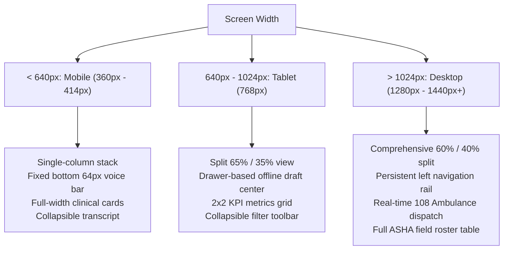

# ASHA Voice Field Register — Design System Specification
**Project Reference:** `projects/12337212643351304899`  
**Design System Name:** Frontline Clinical Field (`assets/ea10c19f154a4c7b91de57ef3822fe74`)  
**Target Viewports:** 360px (Mobile), 414px (Mobile Large), 768px (Tablet), 1280px+ (Desktop)  

---

## 1. Design Philosophy: Clinical Functionalism

The **ASHA Voice Field Register** serves Accredited Social Health Activists (ASHAs), Auxiliary Nurse Midwives (ANMs), and Primary Health Centre (PHC) Medical Officers. It operates under real-world frontline conditions:
- **Direct Sunlight & Glare:** Clean high-contrast palette (`#0F766E` Teal, `#F8FAFC` Canvas, `#0F172A` Text) with minimum 7:1 to 12:1 contrast ratios.
- **Hands-Free / Voice-First:** Zero normal-workflow typing. All vital recording, field corrections, and read-back confirmations are voice-operated.
- **Low-Tier Android & Browser Performance:** No heavy multi-layered blur or glassmorphism. Crisp 1.5px–2px borders and solid elevation planes.
- **Uncompromising Triage Visibility:** High-stakes danger signs (severe pre-eclampsia, post-partum hemorrhage, severe acute malnutrition) utilize unmistakable crimson alerts (`#DC2626`).

---

## 2. Design Tokens & Color System

### 2.1 Core Palette Tokens
| Token | Hex Value | Usage & Meaning |
|---|---|---|
| `primary` | `#005C55` / `#0F766E` | Primary clinical branding, confirmed actions, verified visits |
| `primary-dark` | `#115E59` | Active/pressed state for primary buttons |
| `primary-container`| `#A3FAEF` | Soft teal highlight for active indicators and selected tabs |
| `secondary` | `#0284C7` / `#006398` | Active speech-to-text recording, audio streams, voice actions |
| `secondary-container` | `#5BB8FE` | Active streaming wave halo, progress fills |
| `critical-danger` | `#DC2626` / `#BA1A1A` | Severe pre-eclampsia, emergency triage flags, ambulance triggers |
| `critical-container` | `#FFDAD6` | High-visibility emergency alert callout background |
| `warning-amber` | `#D97706` | Moderate risk, uncertain extraction fields, offline pending sync |
| `success-teal` | `#0D9488` | Confirmed records, verified immunisations, synced drafts |
| `surface-canvas` | `#F8FAFC` / `#F8F9FF` | Anti-glare field canvas background (reduces solar reflection) |
| `surface-card` | `#FFFFFF` | Primary patient cards, visit drafts, and data clusters |
| `border-divider` | `#CBD5E1` / `#E2E8F0` | Structural borders (1.5px baseline on all cards & inputs) |
| `text-primary` | `#0F172A` / `#0D1C2F` | Primary clinical text, vitals, patient IDs (12:1+ contrast) |
| `text-secondary` | `#334155` / `#3E4947` | Labels, timestamps, secondary metadata (4.5:1+ contrast) |

### 2.2 Elevation & Border Tokens
- **Level 0 (Field Canvas):** Background `#F8FAFC`.
- **Level 1 (Clinical Cards):** Background `#FFFFFF`, border `1.5px solid #CBD5E1`, border-radius `4px` (`rounded`).
- **Level 2 (Active Drawers & Floating Controls):** Background `#FFFFFF`, border `2px solid #94A3B8`, box-shadow `0px 4px 0px 0px #CBD5E1`.
- **Level 3 (Emergency Scrim & Danger Modals):** Scrim `rgba(15, 23, 42, 0.75)`, card border `2px solid #DC2626`.

---

## 3. Typography Scale (Noto Sans)

`Noto Sans` is mandated to maintain typographical optical alignment across English, Devanagari (Hindi), Kannada, and Tamil without layout clipping.

| Style Name | Font Size | Line Height | Font Weight | Usage |
|---|---|---|---|---|
| `display-lg` | 30px | 38px | 700 (Bold) | Desktop command center header |
| `headline-lg` | 26px | 34px | 700 (Bold) | Mobile screen titles & alert headers |
| `headline-md` | 22px | 28px | 700 (Bold) | Beneficiary name, danger banner title |
| `headline-sm` | 18px | 24px | 600 (Semi-bold)| Card section headers, vitals groupings |
| `body-lg` | 17px | 26px | 400 (Regular) | Live conversational transcript lines |
| `body-md` | 15px | 22px | 400 (Regular) | Standard data fields, visit notes |
| `body-sm` | 13px | 18px | 500 (Medium) | Timestamps, worker IDs, ward numbers |
| `label-lg` | 16px | 22px | 600 (Semi-bold)| Primary button labels (`min 48px` touch) |
| `label-md` | 14px | 20px | 600 (Semi-bold)| Form labels, status badge text |
| `label-sm` | 12px | 16px | 700 (Bold) | Triage risk badges, cold-chain markers |

> **Biometric Tabular Figures:** All numeric vitals (Blood Pressure `142/94`, Fetal Heart Rate `144 bpm`, Weight `58.5 kg`, Hemoglobin `9.8 g/dL`) must use `font-variant-numeric: tabular-nums` to enable instant vertical visual scanning.

---

## 4. Voice Session State Specifications

The ASHA voice interface transitions deterministically across 6 visual states:

```
[ IDLE ] ──(User Taps Mic)──> [ LISTENING ] ──(Silence/VAD)──> [ PROCESSING ]
   │                               ▲                                 │
   │                               │ (Barge-In Interruption)         │
   │                               │                                 ▼
[ DISCONNECTED ] <──(Offline)── [ SPEAKING ] <──(Extraction Ready)───┘
```

### State Definitions
1. **`idle`**:
   - Central button: 64x64px circular `#0284C7` with white microphone icon.
   - Status text: *"Tap or Press-to-Talk to Start Visit Recording"*
   - Waveform: Static baseline thin line `#CBD5E1`.
2. **`listening`** (Gnani Prisma v3.0 Streaming STT):
   - Central button: Glowing emerald/cyan pulse with animated outer halo (`pulse 1.5s infinite`).
   - Waveform: 16–32 dynamic oscillating vertical bars (`#0F766E` & `#0284C7`) responding to microphone decibel levels.
   - Status pill: *"Gnani Prisma Streaming: Listening (hi-IN)"* with flashing green indicator.
3. **`processing`** (Extraction & Clinical Validation):
   - Central button: Rotating dual-ring spinner in `#0F766E`.
   - Status pill: *"Analyzing Clinical Vitals & Screening Danger Signs..."*
   - Real-time partial entity pills appear in transcript: `[BP: 142/94]`, `[Edema Detected]`.
4. **`speaking`** (Gnani Timbre v3.0 Streaming TTS Read-Back):
   - Central button: Audio speaker wave icon with active rhythmic pulsation.
   - Status pill: *"Assistant Speaking: Reading Back Field Summary..."*
   - Audio control: Play/Pause/Mute toggle with playback scrubber.
5. **`interrupted`** (Barge-In Active):
   - Triggered when ASHA speaks while Timbre is playing.
   - Visual: Instant amber flash badge: *"Barge-In Detected: Playback Flushed"*.
   - System immediately cuts TTS audio buffer and switches back to `listening` state without losing conversation history.
6. **`disconnected`** / **`error`**:
   - Visual: Warning banner `#DC2626` / `#FFDAD6`: *"Voice Connection Lost — Saving Draft to Local Storage (IndexedDB)"*.
   - Tap-to-retry reconnection button.

---

## 5. Touch Target & Accessibility Guidelines

- **Absolute Minimum Tap Boundary:** 48 × 48 CSS px for all interactive elements.
- **Critical Action Targets:** 56px height for *Confirm & Save Visit*, 64 × 64px for the Central Voice Microphone button.
- **High-Contrast Borders:** Minimum 1.5px border on all inputs and card boundaries to remain clearly legible under direct equatorial sunlight.
- **Multi-Lingual Script Support:** All containers enforce generous vertical padding (`space-sm` / 8px) to prevent vertical clipping of Hindi/Kannada matras and diacritics.

---

## 6. Responsive Layout Breakpoints



---

## 7. Component Architecture Mapping (Next.js)

| Stitch Component | Next.js Component File | Role / Capabilities |
|---|---|---|
| **Active Voice Session** | `src/components/voice/ActiveVoiceSession.tsx` | Full-screen voice workflow with live waveform, transcript, and mic button |
| **Microphone Trigger** | `src/components/voice/VoiceMicButton.tsx` | 64x64px haptic-ready button with idle/listening/pulsing animations |
| **Audio Waveform** | `src/components/voice/LiveAudioWaveform.tsx` | Web Audio API / Canvas real-time visualizer responding to mic stream |
| **Danger Alert Banner** | `src/components/alerts/CriticalDangerBanner.tsx` | Red/Amber emergency triage banner with direct referral guidance |
| **Structured Review Card** | `src/components/visit/StructuredVisitCard.tsx` | Extracted vitals, immunisation due, and clinical measurements |
| **Field Voice Correction** | `src/components/visit/FieldVoiceCorrection.tsx` | Dashed amber uncertain-field highlight with tap-to-correct voice trigger |
| **Spoken Read-Back** | `src/components/voice/TimbreReadBackPlayer.tsx` | Audio player for synthesized Hindi/Kannada visit summary |
| **Offline Draft Drawer** | `src/components/offline/OfflineDraftDrawer.tsx` | IndexedDB-backed draft list with pending/syncing/failed states |
| **Supervisor Command Center**| `src/components/supervisor/SupervisorCommandCenter.tsx` | Desktop MOIC dashboard with KPI cards and dual-column triage queue |
| **Alert Queue Item** | `src/components/supervisor/DangerAlertQueueItem.tsx` | Triage card with 1-click *Dispatch Ambulance 108* and *Call ASHA* |
| **ASHA Field Roster** | `src/components/supervisor/AshaFieldRosterTable.tsx` | Real-time monitoring table with sync status and visit quotas |

---

## 8. Implemented Two-Mode & Responsive Component Mapping (`v1` Overhaul)

> Note: Stitch MCP server was unavailable during this overhaul session; the tokens above (`#0F766E`, `#0284C7`, `#DC2626`, `#D97706`, `#F8FAFC`, `Noto Sans`, 44px+ coarse touch targets) were centralized in `tailwind.config.ts` and `src/app/globals.css` and applied uniformly across all components below.

| Component Area | Implemented File(s) |
|---|---|
| **Responsive App Shell & Nav** | `src/components/layout/AppShell.tsx` |
| **Auth & Synthetic Role Switcher** | `src/components/auth/LoginScreen.tsx` |
| **Two-Mode Selector (Basic / Advanced)** | `src/components/voice/ModeSelector.tsx`, `src/components/voice/VoiceVisitWorkspace.tsx` |
| **Basic Mode (6-Step Simple Flow)** | `src/components/voice/BasicVisitView.tsx` |
| **Advanced Mode (8 Clinical Sections)** | `src/components/voice/AdvancedVisitView.tsx` |
| **Beneficiary / Language / Recorder** | `BeneficiarySelector.tsx`, `LanguageSelector.tsx`, `VoiceRecorderAndTranscript.tsx` |
| **Review, Read-back, Correction & Save** | `src/components/voice/VisitReviewShared.tsx` |
| **Urgent Danger Alert Override** | `src/components/DangerAlertBanner.tsx` |
| **ASHA Secondary Views** | `src/components/asha/{AshaHomeView,BeneficiaryDirectoryView,FollowUpQueueView,VisitHistoryView,OfflineDraftsView}.tsx` |
| **PHC Supervisor Command Center** | `src/components/supervisor/{SupervisorOverviewAndAlerts,SupervisorWorkersAndRegister,SupervisorAnalyticsAndReports}.tsx` |
